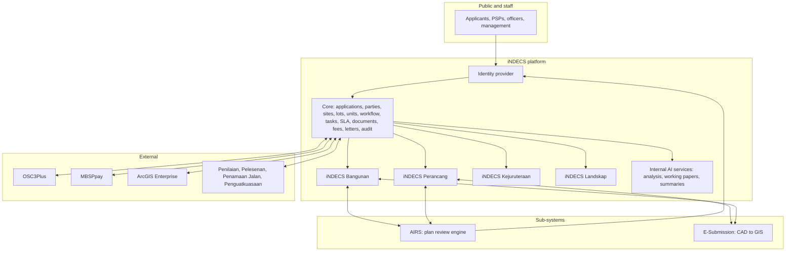

# 10. Platform Landscape

Version 2.0, 2026-09-18.

## 1. The four systems

| System | Owner and builder | Stack | State on 2026-09-18 | Role going forward |
|---|---|---|---|---|
| **iNDECS** (Intergrated Development Control System) | MBSP, built in-house by the same developer | Laravel 13, Blade, SQLite in development | Conceptual, with one working slice: PKM registration and completeness review. Binding design documents exist | **The platform and main portal.** System of record for every development-control application. Identity provider for the family |
| **AIRS** (AI Review Studio) | MBSP, same developer | Laravel 13, Blade, Tailwind, Python document worker, cloud OpenAI behind a provider-neutral contract | Mockup and beta stage. Working review engine for LJUP street-lighting plans, officer workflow, billing and letters in staging. `BUILDING_PLAN` module slot present, disabled | **Plan-review sub-system.** Reviews submitted plans against versioned rule packs and returns evidence-linked findings. Can stand alone |
| **E-Plan Submission System Phase 1** | Vendor: Esri Malaysia, under MBSP contract | .NET 10, ArcGIS Portal identity, ETL to GIS | Requirements v1.2 signed February 2026; delivery in progress | **Spatial submission sub-system.** PSPs submit CAD and Excel; ETL loads GIS; admins verify. Can stand alone |
| **Sistem Bangunan 2.0** | Vendor: WiseCore, legacy | VB.NET WinForms, SQL Server `MPSP_Bangunan` | Production, 32,860 applications, critical security findings | **To be retired** when iNDECS Bangunan reaches cut-over |

## 2. Division of responsibility

Rules that follow from the decisions:

1. **iNDECS holds the record.** Application status, decisions, approvals and letters are iNDECS data. AIRS findings and E-Submission spatial data are attached to the iNDECS application, never the other way round.
2. **AIRS reviews, iNDECS decides.** AIRS keeps its own charter: it never approves. Officer confirmation of findings can happen in AIRS or in iNDECS, but the resulting decision is recorded in iNDECS.
3. **E-Submission owns the CAD-to-GIS pipeline.** iNDECS references the resulting GIS features and submission status; it does not re-implement the ETL.
4. **One login.** iNDECS issues identity; AIRS trusts it; E-Submission accounts are linked by identity number because its identity is vendor-controlled.
5. **Each sub-system must still run alone.** Contracts are versioned APIs, not shared databases.
6. **AI split.** AIRS: review of submitted plans and documents, including classification and extraction. E-Submission: spatial data. iNDECS internal AI: analysis across applications, working papers, summaries, dashboard narratives, natural-language search.

## 3. Decisions that bind this programme

Taken with the programme owner on 2026-09-18. Full records in the decision log.

| Decision | Value |
|---|---|
| Module identity | iNDECS Bangunan, route `/bangunan`, table prefix `APP_PB_` per iNDECS design direction, type codes PB, PBK, PBS, PMT, TEL, reference `<TYPE>/YYYY/NNNNN`. The earlier working name is retired everywhere |
| Stack | Laravel, following iNDECS conventions |
| Database | PostgreSQL 16 with PostGIS, one cluster; iNDECS one database with schemas; AIRS its own database |
| Legacy approach | Nightly read-only sync for early web lookups, one-time migration at cut-over, legacy read-only then retired |
| Identity | iNDECS is the identity provider for iNDECS and AIRS; E-Submission linked by identity number |
| Integration | Versioned APIs between all systems; every system runs alone if another is down |
| Design | AIRS creative direction is the example for UI across the family |
| AI hosting | Cloud-hosted models now behind a provider-neutral contract; migration to self-hosted when MBSP infrastructure allows |
| Sequencing | iNDECS Bangunan brought forward by management; core capabilities built alongside as Bangunan needs them |
| Hygiene | Repositories, CI, PostgreSQL and a handover pack are a prerequisite, not a later phase |

## 4. What each system contributes to Bangunan

| Bangunan need | Provided by | Notes |
|---|---|---|
| Application record, parties, lots, documents, audit, reference numbers | iNDECS core, exists | Tested pattern from the PKM slice |
| Workflow engine, RBAC, fees, payments, notifications, SLA, letters, units | iNDECS core, to build | Bangunan is the first consumer |
| Public accounts, magic links, company records, payment gate | AIRS pattern, to lift into iNDECS core | Already designed and partly built in AIRS |
| Plan review, document classification, field extraction, evidence-linked findings | AIRS, activate `BUILDING_PLAN` | Needs a Bangunan rule pack and OCR wiring |
| Footprints and lot geometry from CAD | E-Submission plus ArcGIS Enterprise | Via GIS feature references |
| Analysis, working papers, summaries | iNDECS internal AI services, to build | Reuses the AIRS provider contract |
| Historical data | Sistem Bangunan 2.0 | 33 tables reconstructed in the teardown |

## 5. The single largest risk

Every in-house system in this landscape is built and known by one person. Architecture cannot fix that; the engineering hygiene document sets out the controls that reduce it, and the programme master narrative must ask management for at least one more developer.

## Open questions

1. Delivery date and scope of E-Submission Phase 1, and whether a Phase 2 covering building plans is planned with Esri. Owner: programme owner. Needed by: Bangunan Phase C.
2. Whether MBSP ICT permits a PostgreSQL cluster in the data centre or mandates SQL Server. Owner: ICT. Needed by: Phase A month 1.
3. Whether E-Submission's ArcGIS Portal can federate with an external identity provider, which would remove the identity-number linking workaround. Owner: Esri Malaysia via programme owner. Needed by: Phase C.
