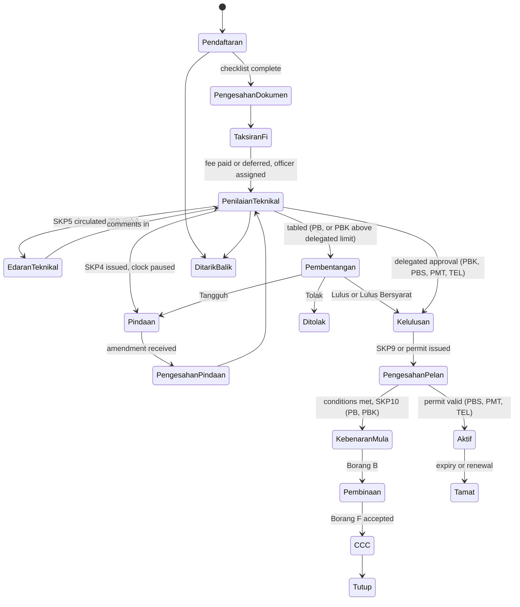

# 13. iNDECS Bangunan Module Specification

Version 2.0, 2026-09-18. Replaces the version 1 Phase 0 and Phase 1 specifications. Follows iNDECS `AGENTS.md` and `docs/DESIGN-DIRECTION.md`.

## 1. Identity of the module

| Item | Value |
|---|---|
| Name | iNDECS Bangunan |
| Menu | Bangunan |
| Route prefix | `/bangunan` |
| Table prefix | `APP_PB_` per the iNDECS design direction. The existing PKM slice uses lowercase `pkm_`; the Bangunan module follows the design direction and any remaining PKM table-name alignment is handled during its workflow-engine migration, which now runs concurrently with Bangunan (ADR-212) |
| Reference format | `PB/2026/00310`, allocated by the core reference generator. Legacy `MBSP/40/50-47/19` and OSC references kept as searchable aliases in `external_reference` and an alias table |
| Department | `JBANG`, already seeded |
| Workspace | The standard 17-tab shell: Ringkasan, Butiran, Pemohon & Perunding, Tapak & Lot, Peta, Borang Jabatan, Dokumen, Fi & Bayaran, Pergerakan Fail, Ulasan Teknikal, Tugasan, Mesyuarat, Keputusan, Kelulusan, Permohonan Berkaitan, Garis Masa, Sejarah Audit. Only Borang Jabatan is Bangunan-specific |

## 2. Application families

All five are `application_types` under primary department `JBANG`, each with its own workflow template, requirement catalogue, fee rules and letter set. All attach to core `applications`.

| Type code | Family | Route today | Distinct features |
|---|---|---|---|
| `PB` | Pelan bangunan penuh | Via OSC3Plus | OSC reference mandatory; Serentak variant with KM and PS dates; full SKP series; CCC stages; committee decision; often linked to a PKM application through a development case |
| `PBK` | Pelan Tambahan / Ubahsuai Kecil | Direct | Fast-track lane flag; may skip committee under delegated authority; simplified CCC (Borang F only) |
| `PBS` | Pelan Bangunan Sementara and Permit Sementara Seksyen 19 | Direct | Validity period and renewal; permit letter instead of SKP9; no CCC |
| `PMT` | Permits: meletak bahan binaan, perancah, runtuh, tukar guna | Direct | Deposit for road reserve; demolition requires clearance; change of use updates an existing unit |
| `TEL` | Telco structures and renewable permits | Direct | Structure inventory; annual renewal and billing |

Type codes were approved by the programme owner on 2026-09-18 (ADR-210). They do not collide with the other departments' codes (PKM, PKT, PKP, PL).

## 3. Workflow

The iNDECS design direction fixes the Bangunan stage list: Pendaftaran, Pengesahan dokumen dan pelan, Taksiran fi, Penilaian teknikal bangunan, Pindaan, Pengesahan pindaan, Kelulusan, Pengesahan pelan, Tutup. The full `PB` family extends it with technical circulation, committee and CCC stages; the smaller families use subsets. All run on the core workflow engine (C3).

Legacy `PmnStatus` codes (B, L, S, BK, K, T, CCC, CCC2a, CCC3, CCC4) and branch dates (`PmnTkhTolak`, `PmnTkhBatal`, `PmnTkhTangguh`, `PmnTkhLulus`) map onto these states during migration. Guards live in the engine configuration: required role, separation of duties (recommender cannot approve), required artefacts (a decision needs a meeting record, an approval letter needs a paid fee unless waived).

## 4. Extension tables

Per the iNDECS overview, all in schema `bangunan`, keyed by `application_id`.

| Table | Content |
|---|---|
| `APP_PB_APPLICATION` | Building category and use, plan types (senibina, struktur, sanitari), OSC dates, Serentak flag, KM and PS dates, delegated-authority flag, fast-track flag |
| `APP_PB_BLOCK` | Blocks per application: building type, storeys, units, height |
| `APP_PB_FLOOR` | Floors per block: area, use, fee band |
| `APP_PB_COMPONENT` | Approved components: setbacks, parking provision, accessibility items |
| `APP_PB_GREEN` | OTTV inputs and result, SPAH catchment and tank size, OKU checklist items (MS 1184) |
| `APP_PB_CONDITION` | Approval conditions with compliance evidence |
| `APP_PB_CCC` | Borang B, G1 to G21, F, F1 records with PSP party and attachment; stage CCC1 to CCC4 |
| `APP_PB_NOTICE` | Notices: type, recipient, deadline, status, handover package reference |
| `APP_PB_TELCO_STRUCTURE` | Structure inventory: location, type, operator, height |
| `APP_PB_PERMIT` | Validity period, renewal cycle, reminder history (PBS, PMT, TEL) |
| `APP_PB_BRIEF` | Structural and sanitary review records (legacy `BERIF`) |
| `legacy_*` | Nightly read-only copies of the 33 `MPSP_Bangunan` tables during Phase A and B; dropped after retirement |

Everything else (parties, lots, sites, units, documents, fees, payments, tasks, meetings, decisions, approvals, letters, technical reviews, file movement, audit) is core.

## 5. Legacy migration

### 5.1 Phase A: read-only sync

A scheduled job copies `MPSP_Bangunan` tables into `bangunan.legacy_*` nightly through a read-only SQL Server login. iNDECS shows list and detail screens over these copies in the Bangunan shell, so staff gain web lookups and search while the WinForms app remains the writer. Duplicate detection (lots, parties, consultants) runs against the copies and feeds the core units and parties registries with `source = legacy` and confidence scores; the review queue and merge tooling from version 1 are unchanged.

### 5.2 Phase B: cut-over per family

Order: TEL, then notices, then meetings, then fees, then CCC, then PB, PBK, PBS, PMT together. For each: freeze the legacy menu via `USERACCESS`, run the final migration script for that module's rows into core and extension tables, verify counts and field comparisons, switch staff to iNDECS. There is no dual-writing; between freeze and switch, that module is briefly read-only, which is acceptable for a family-by-family move done at weekends.

### 5.3 Retirement

Final reconciliation signed by the product owner; legacy removed from the WiseCore loader; `USERINFO.USERPASSWORD` nulled; shared SQL login dropped; `setting.xml` removed; `dbo` tables denied write; media bytes extracted to MinIO with hash verification; nightly sync stopped and `legacy_*` tables dropped after a retention period agreed with the product owner.

### 5.4 Mapping summary

| Legacy | Destination |
|---|---|
| `PERMOHONAN1` | `core.applications`, `application_parties`, `application_sites`, `application_lots`, `APP_PB_APPLICATION`, stage history reconstructed from date columns |
| `BANGUNAN1` | `APP_PB_BLOCK`, `APP_PB_FLOOR`, then `core.units` |
| `PERUNDING` | `core.parties` (consultants) plus application party snapshots |
| `CCC` | `APP_PB_CCC` |
| `ULASAN`, `ULASANJABATAN` | `core.technical_reviews` and comments |
| `NOTIS` | `APP_PB_NOTICE` |
| `PELANBAYARAN`, `BAYARANDETAIL`, `KadarBayaran` | `core.fee_assessments`, `payments`, `fee_rules` |
| `PRODUKTIVITI` | Derived from stage history; not migrated as a table |
| `BentangMesyuarat`, `SYARAT`, `BERIF`, `BUKUPANDUAN` | `core.meetings`, `APP_PB_CONDITION`, `APP_PB_BRIEF`, guidebook track as a document type |
| `KABINET` | `core.files` and `file_movements` with QR labels |
| `Media`, `MediaH` | `core.documents` in MinIO |
| `Telco` | `APP_PB_TELCO_STRUCTURE`, `APP_PB_PERMIT` |
| `USERINFO`, `USERACCESS`, `ACCESSINFO` | Users via the staff identity source; permissions mapped to roles |
| `SENARAI*` | Core reference lists |

## 6. Functions

All functions from version 1 remain in scope. Their new home:

| Function | Home |
|---|---|
| Registration, checklist, assignment, technical review, circulation, amendments, decisions, conditions, withdrawal | Bangunan module on core workflow |
| SKP letter series, permit letters, CCC letters, QR verification, supersession | Core letters (C9) with Bangunan templates. The 165 Crystal templates are culled to an approved list, expected around 40 |
| Fee engine reproducing per-floor and special rates, deposits and refunds, Seksyen 70(11) fines | Core fees (C5) with Bangunan rules |
| Renewal engine for TEL and PBS | Core scheduler, Bangunan configuration |
| Committee tabling: agenda, kertas pembentangan, decisions | Core meetings (C10); narrative sections drafted by internal AI in Phase D |
| Green calculators (OTTV, SPAH, OKU) | Bangunan Borang Jabatan; results feed the compliance checklist |
| Notices with handover to Penguatkuasaan | Bangunan module, core events |
| Physical file QR labels | Core file movement |
| Plan review, document classification, field extraction | AIRS via the contract in document 12 |
| Public submission, fee calculator, tracking, appointments, online Borang B/G/F | Core public portal with Bangunan configuration |
| Extension-plan designer with template library and rule checks | Bangunan public feature, Phase D; output PDF and design JSON attached to a PBK application; footprint optionally pushed via E-Submission |
| Statistical reports and KPKT returns | Core reports (C12) with Bangunan definitions |
| Unit lifecycle events to Penilaian, Pelesenan, Penamaan Jalan, GIS | Core units (C7) and events (C11), triggered by Bangunan CCC |
| Mobile inspections | Phase E, core PWA |

## 7. Bangunan work by phase

| Phase | Bangunan deliverables |
|---|---|
| A | Legacy sync and lookup screens; duplicate detection feeding registries; discovery reports (OSC3Plus, MBSPpay, E-Submission contract, GIS); family type codes and requirement catalogues confirmed |
| B | Five family configurations on the engine; extension tables; fee rules; letter templates; committee flow; green calculators; notices and handover; renewals; migration scripts; family-by-family cut-over; legacy retirement |
| C | Public portal configuration for all families; online Borang B/G/F; AIRS `BUILDING_PLAN` live for review and auto-fill; E-Submission references on applications; OSC3Plus link |
| D | Working papers with AI drafting; compliance summaries; KPKT returns; consultant scoring; unit events downstream; extension-plan designer |
| E | Mobile inspections |

## 8. Testing

- Workflow: exhaustive transition tests per family configuration including forbidden transitions and separation of duties.
- Fees: golden tests against 200 historical applications comparing computed fees to legacy `BANGUNAN1` totals.
- Letters: snapshot tests per template; QR round trip; supersession.
- Migration: per-module count and field comparison scripts run in CI against a scrubbed snapshot.
- Browser journeys: registration to SKP9; permit to renewal; notice to handover; meeting decision to letter; public submission to payment.

## Open questions

1. Whether OSC references must be unique across departments. Owner: product owner. Needed by: Phase A month 2.
2. Final letter template list from the 165 Crystal reports. Owner: product owner. Needed by: Phase B month 2.
3. Delegated authority thresholds for PBK. Owner: Pengarah. Needed by: Phase B month 5.
4. Finance receipt numbering and refund voucher format. Owner: Jabatan Kewangan. Needed by: Phase B month 4.
